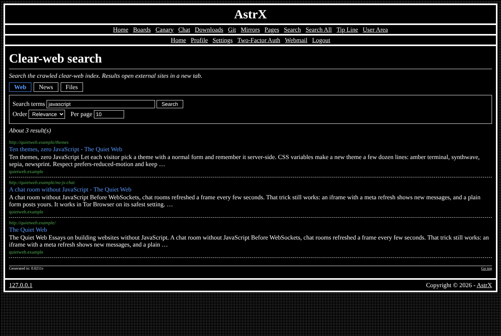

# astrx/module-websearch

Clear-web search page backed by the astrx-suite web search engine — the **Clear-web search** module of [AstrX](https://github.com/Vxmdzhb/astrx).



- Module key: `websearch` (switch it on in the site's `resources/config/Modules.config.php`)
- Pages: `web_search`
- Requires: `astrx/cms`, `astrx/framework`, `astrx/library`

The installer creates the page with its link in the navbar switched off,
because the federated search ([module-fedsearch](https://github.com/Vxmdzhb/module-fedsearch))
already offers this engine as a tab. Switch the link on in Admin → Navbar
to list the page on its own.

It ships its own templates, catalogs (en, it), default configuration and SQL in
`resources/`; the site overrides any of them from its own `resources/`.

AstrX isn't on Packagist and doesn't tag versions: you install from each
repository's `main`, and your `composer.lock` pins the exact commit. Tell
Composer where to find the package and the AstrX packages it depends on:

```json
{
    "minimum-stability": "dev",
    "prefer-stable": true,
    "repositories": [
        { "type": "vcs", "url": "https://github.com/Vxmdzhb/module-websearch" },
        { "type": "vcs", "url": "https://github.com/Vxmdzhb/cms" },
        { "type": "vcs", "url": "https://github.com/Vxmdzhb/framework" },
        { "type": "vcs", "url": "https://github.com/Vxmdzhb/library" }
    ]
}
```

Then:

```sh
composer require astrx/module-websearch:dev-main
```

After that, list `AstrX\WebSearch\WebSearchModule::class` in the
site's `ApplicationModules::INSTALLED` and run the installer to create its
tables. See [modules](https://github.com/Vxmdzhb/astrx/blob/main/docs/MODULES.md).

Issues and pull requests are welcome here. [AstrX](https://github.com/Vxmdzhb/astrx)
is the site that puts all the packages together.
